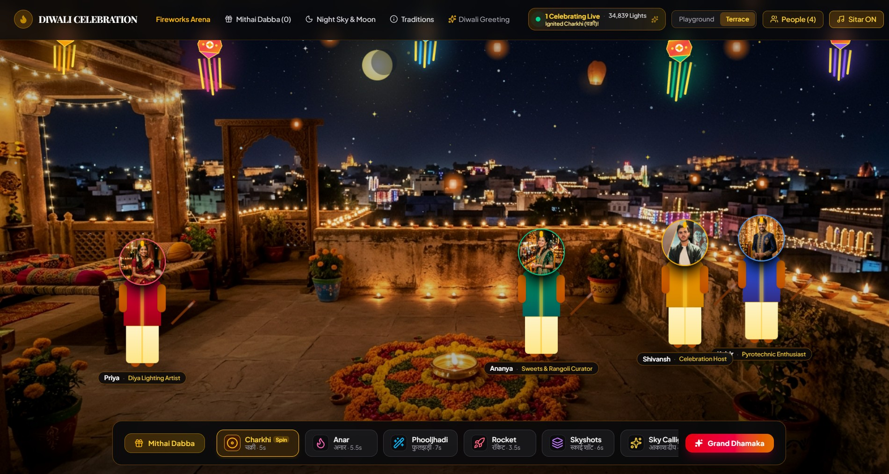

# Diwali Celebration Web App 🪔

An immersive, highly interactive web application designed to bring the joy and lights of Diwali to your screen. Experience the festival of lights with physics-based virtual fireworks, interactive characters, traditional sweets, and festive music, all built seamlessly with modern web technologies.

## ✨ Festive Diwali Experience



## ✨ Features

* **Interactive Cracker Arena:** Drag and drop a variety of virtual fireworks from the inventory dock—including *Charkhi*, *Anar*, *Phooljhadi*, *Rocket*, and *Skyshots*—onto the scene to ignite them.
* **Physics-Based Visuals & Audio:** Each firework features highly detailed, physics-based particle effects perfectly synchronized with high-quality sound effects using the Web Audio API. 
* **Dynamic Festive Environments:** Toggle between different celebration settings like the "Playground" and the "Terrace" under a glowing night sky.
* **Animated Characters:** Interact with lively characters (e.g., Priya, Ananya, Kabir, and Aarav). Drag fireworks to them to see realistic ignition motions, or read their dynamic festive reactions via chat bubbles.
* **Mithai Dabba (Sweets Box):** Share the joy by distributing traditional Diwali sweets to the characters on screen, triggering warm, celebratory animations.
* **Immersive Intro Showreel:** Begins with a stunning 10-second WebGL/Canvas-based motion graphics sequence and a 3-2-1 countdown that bursts into a vibrant Diwali greeting.
* **Festive Controls:** Toggle background Sitar music, adjust the night sky settings, and track the number of "Live Celebrations" happening in the arena.

## 🛠️ Tech Stack

* **Frontend Framework:** React
* **Styling:** Tailwind CSS
* **Animations:** Framer Motion & Canvas/WebGL
* **Audio:** Web Audio API

## 🚀 Getting Started

### Prerequisites
* Node.js (v16 or higher)
* npm or yarn

### Installation

1. **Clone the repository:**
   ```bash
   git clone [https://github.com/yourusername/diwali-celebration-app.git](https://github.com/yourusername/diwali-celebration-app.git)
   cd diwali-celebration-app
